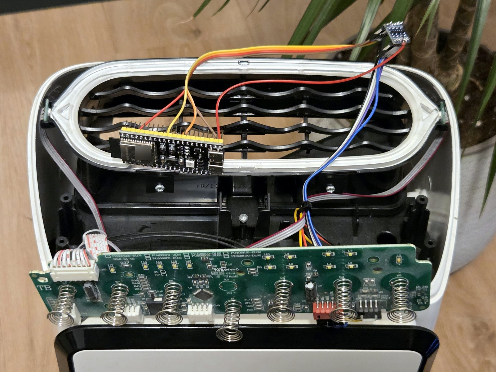

# Rowenta Pure Air Cloud Rescue

Rowenta's **Pure Air** app no longer works, and the "connected" purifiers that depended on it
lost their remote control and schedules. This project brings them back, **without any cloud
from the manufacturer**: the original WiFi module is unplugged and replaced with a ~12 € ESP32-S3
board that talks directly to the purifier's control board.

The result has been running on a Rowenta **PU4080F0** (Intense Pure Air Connect) since October 2026.

> [!WARNING]
> This guide involves opening a mains-powered appliance and soldering. **Read the
> [safety warnings and disclaimer](#safety-warnings-and-disclaimer) before you start.**
> If you have never soldered, **take this guide to a professional or someone with more
> experience**.

## Compatible models

| Confidence | Models | Why |
|---|---|---|
| **Tested** | **PU4080F0** | The author's purifier. Everything in this repo was built and verified on it. |
| **Same control board** | PU6080F0, PU4085G0, PU6085G0, PU4081U0, PU6081U0, PU6075K0 | Printed on the silkscreen of the control board `PU4080F0-DL02` as variants of the same board. The WiFi carrier board is labelled `PU6080F0_DL03`. Very likely to work, but **not tested**. |
| **Probably compatible (unverified)** | PU6086; Tefal-branded twins of the Intense Pure Air Connect line | Sold as the same family and supported by the same app. Check that your board has the red **CN6** header described in [docs/hardware.md](docs/hardware.md). |
| **Unknown hardware** | Other Pure Air app purifiers (Pure Air Genius, Pure Home, Pure Air City…) | Different products. The [research guide](docs/research-tools.md) explains how to find out whether they use the same protocol. |

**Did you try it on your model?** Please
[open a model compatibility report](../../issues/new?template=model-compatibility.yml) with a
photo of the board, whatever the result. That is how this table grows.

## What you gain

- **Local control from any browser** at `http://purifier.local`: power, mode
  (Auto / Silent / Night / Turbo), light, particle reading.
- **Voice control with Google Home / Gemini** ("turn off the purifier"), through the free
  [Sinric Pro](https://sinric.pro) service. No Google Nest speaker needed.
- **Weekly schedule** stored in the purifier itself: it keeps working even if the internet is down
  (once the clock has been set after power-up).
- **Air quality from anywhere** in the Sinric Pro app, plus **phone alerts** when the particle
  level at home goes above a threshold you choose.
- **Independence**: nothing depends on Rowenta's servers any more. The code is yours.
- **Updates over WiFi**: no need to open the purifier again to update the firmware.
- **About 25 € in parts**, and the change is reversible: the original module just unplugs.

## Safety warnings and disclaimer

- The purifier runs on **mains voltage**. **Always unplug it** before opening it or touching
  any wire. Never touch the mains input area of the board.
- Before connecting a computer to the purifier while it is plugged in, **check the isolation**:
  with the purifier unplugged, measure between the board's GND and each pin of the mains plug;
  the multimeter must read open (OL). See [docs/research-tools.md](docs/research-tools.md#1-safety-first-check-the-isolation).
- **Never power the ESP32 from USB and from the purifier at the same time.**
- Sending undocumented commands to the control board can leave it in strange states (the author's
  stopped its motor until a rescue command was found; see [docs/protocol.md](docs/protocol.md)).
  The firmware in this repo only sends commands that were verified.
- Opening the purifier **voids its warranty**.
- This project is **not affiliated with, endorsed by or connected to Rowenta or Groupe SEB**.
  Rowenta, Tefal and Pure Air are trademarks of their respective owners.
- You follow this guide **at your own risk**. The author accepts no responsibility for damage to
  your appliance, your property or yourself. The software is provided "as is", without warranty
  (see [LICENSE](LICENSE)).
- **If you don't know how to solder or don't feel confident, take this guide to a professional
  or to someone with more experience.**

## Skills and tools you need

- **You must know how to solder.** Two header strips and one extra wire have to be soldered on
  the level shifter.
- Soldering iron and solder.
- Multimeter.
- Plastic pry tool (spudger / opening wedge) and a screwdriver.
- A computer with a USB cable to flash the ESP32 the first time.

## Bill of materials

| Part | Notes | Approx. price |
|---|---|---|
| ESP32-S3 DevKitC-1 (N16R8 or similar) | Clones are fine; the author's has a CH343 USB chip and a `5Vin` pin | ~12 € |
| Bidirectional logic level shifter, 4 channels, 3.3 V ↔ 5 V (BSS138) | Only 2 channels are used | 1–8 € (often sold in packs) |
| Female–female Dupont jumper wires | About 9 | ~5 € (kit) |
| *Optional:* 5-pin JST XH cable | Holds firmly on the CN6 header (Dupont plugs are loose there) | ~3 € |
| *Optional:* 3D-printed case | | – |
| **Tools:** soldering iron, solder, multimeter, plastic pry tool | Required | – |
| *Optional, only for research:* 24 MHz 8-channel USB logic analyzer | Works with sigrok/PulseView (**not** with Saleae Logic 2) | ~10 € |

Total for the parts: **about 25 €**.

## How it works, in short

1. **Unplug** the purifier, unscrew the back cover and pry off the black top cover
   ([installation](docs/installation.md)).
2. **Unplug the original WiFi module** from the red CN6 header of the control board. It can go
   back at any time.
3. **Wire the ESP32** to CN6 through the level shifter ([wiring](docs/hardware.md#wiring)).
4. **Flash the firmware** from [firmware/](firmware/) over USB.
5. **Join it to your WiFi** through the `Purifier-Setup` network and open `http://purifier.local`.
6. Optionally, **connect Google Home** through [Sinric Pro](docs/sinric-google.md).
7. Tuck everything inside and close the purifier.

## Documentation

| Document | Contents |
|---|---|
| [Background](docs/background.md) | What happened to the app, and how this project got here |
| [Hardware](docs/hardware.md) | Control board, connectors, original module, wiring diagram |
| [Installation](docs/installation.md) | Step-by-step guide with photos |
| [Sinric Pro and Google Home](docs/sinric-google.md) | Voice control, remote air quality and alerts |
| [Troubleshooting](docs/troubleshooting.md) | Problems already met and their fixes |
| [Protocol](docs/protocol.md) | The serial protocol between the module and the board |
| [Research tools](docs/research-tools.md) | How to capture and decode the signals on another model |
| [Roadmap](docs/roadmap.md) | Ideas for the future |

Repository layout: [firmware/](firmware/) (the purifier firmware),
[firmware-bridge/](firmware-bridge/) (USB-serial bridge for research), [tools/](tools/)
(Python tools), [captures/](captures/) (reference logic analyzer recordings),
[images/](images/).

## Known limitations

- Google Home shows the fan speeds with odd names ("low / medium / high / 1 / 2 / 3 / 4");
  numbers 1–4 map to Night, Silent, Auto and Turbo.
- Google Home refreshes the air quality value rarely; the Sinric Pro app and the local page are
  up to date.
- From Google, the light is only on/off (the dim level works from the local page).
- The panel's TIMER and FILTER buttons are not reported by the board, so the firmware can't see them.
- Only 2.4 GHz WiFi networks are supported (ESP32 limitation).

## License and credits

- Code (firmware and tools): [MIT](LICENSE).
- Documentation and photos: [CC BY 4.0](LICENSE-docs.md).

Made by Alejandro Couso ([@acvx93](https://github.com/acvx93)). Built on
[WiFiManager](https://github.com/tzapu/WiFiManager), [ArduinoJson](https://arduinojson.org),
[Sinric Pro](https://github.com/sinricpro/esp8266-esp32-sdk) and [sigrok](https://sigrok.org).
