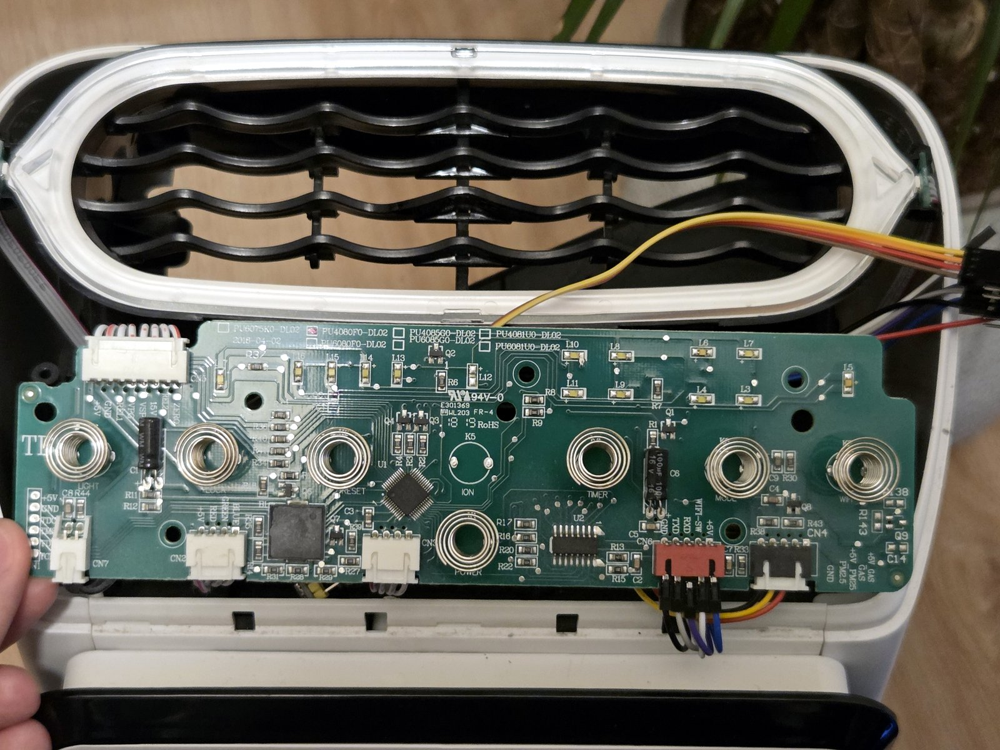
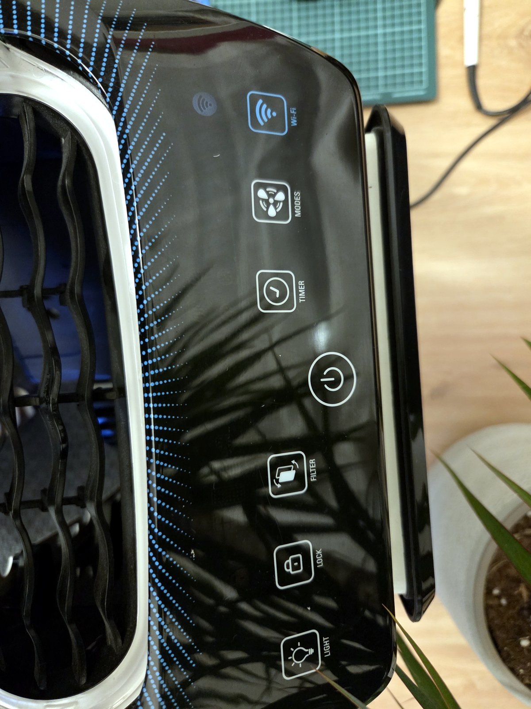
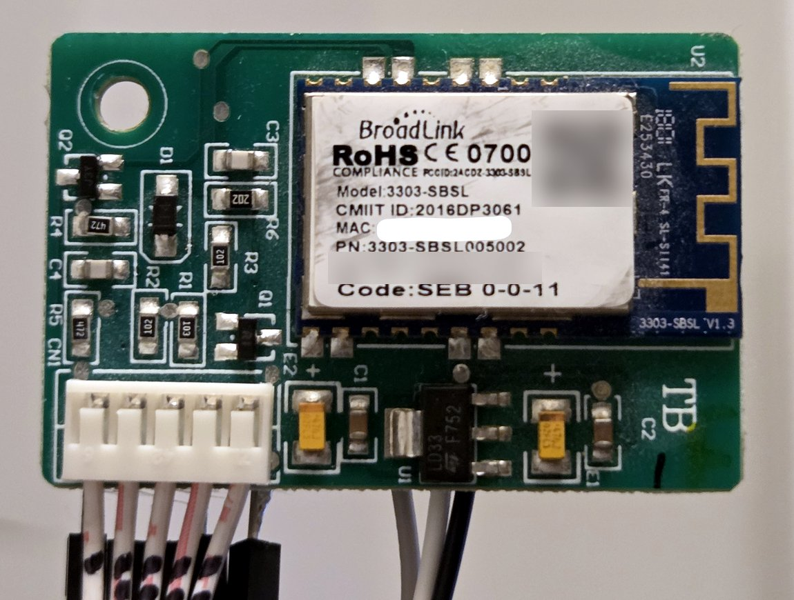
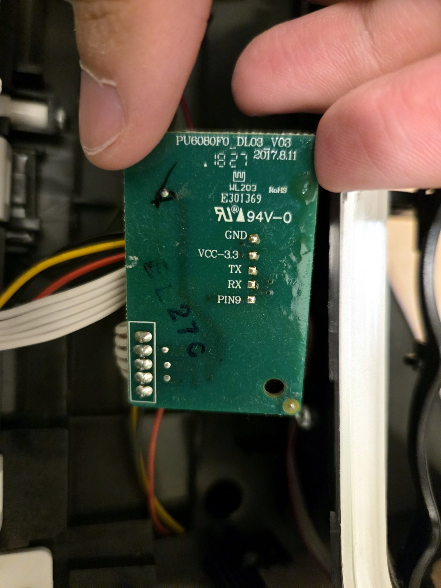
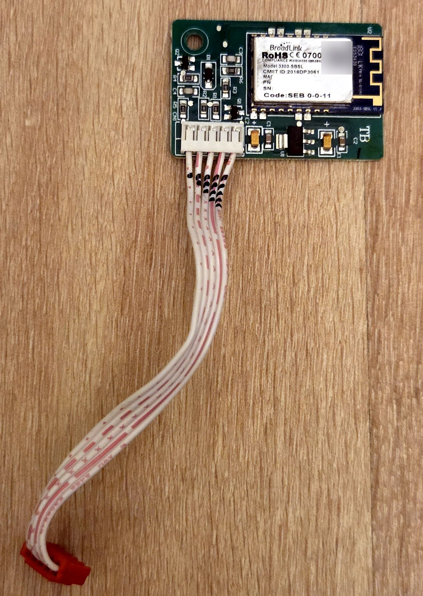
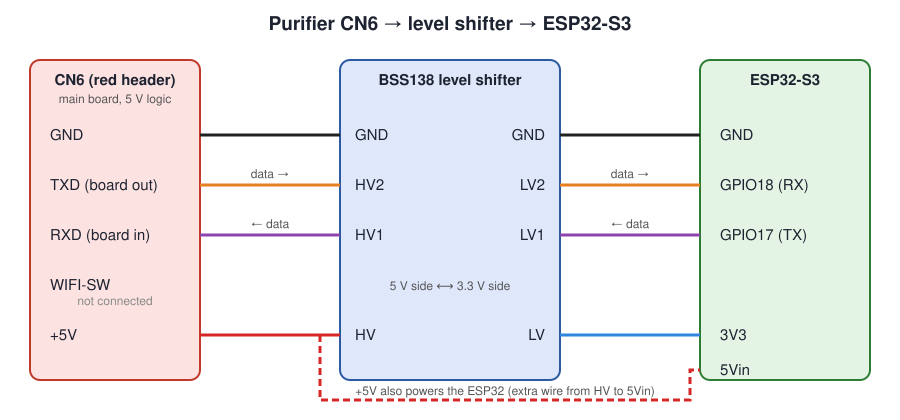
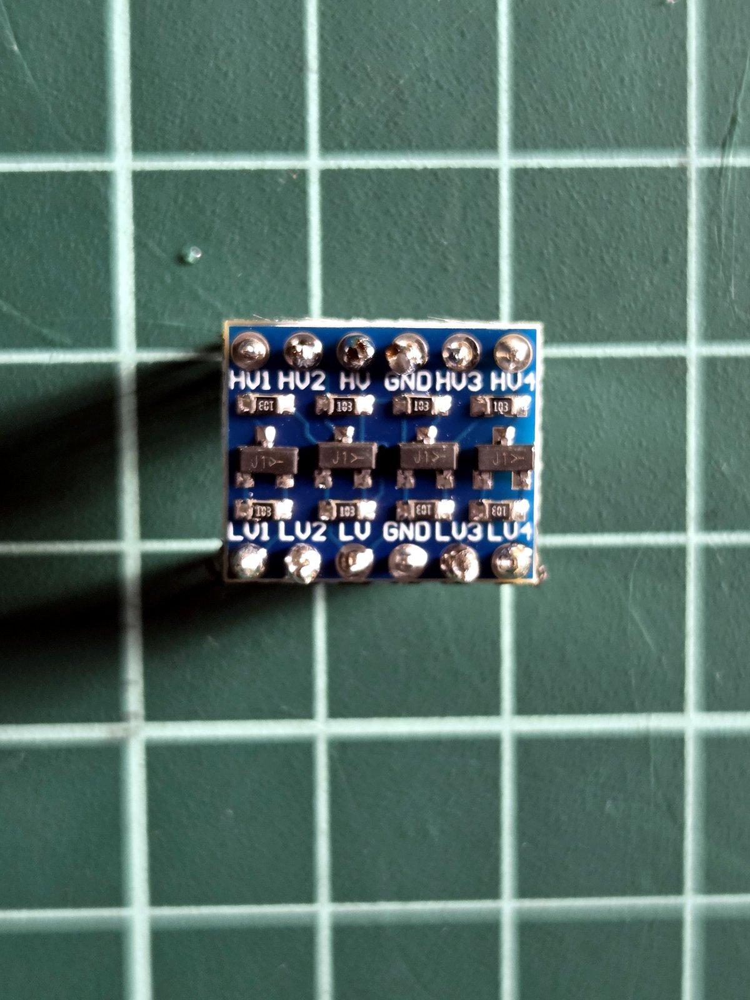
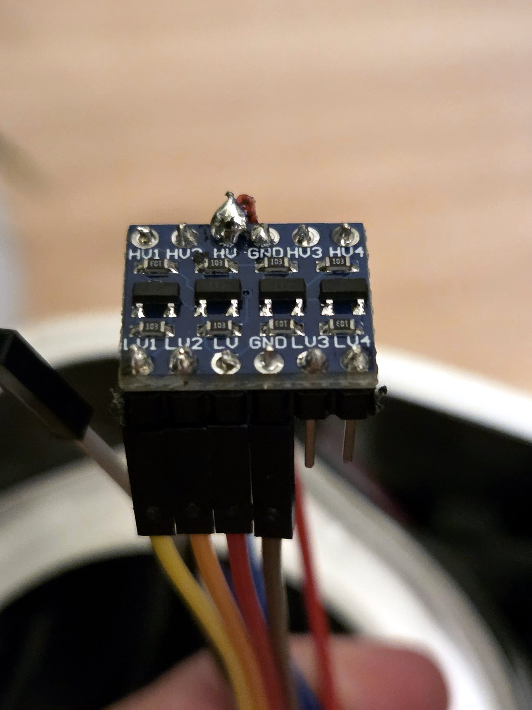
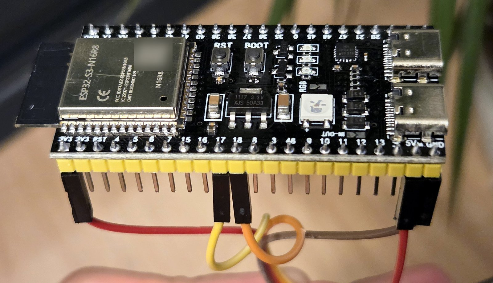

# Hardware

Everything described here is on the **PU4080F0**. Boards of the related models listed in the
[README](../README.md#compatible-models) should look the same; if yours doesn't, please report it.

## Control board `PU4080F0-DL02`

The control board sits right under the black top cover, behind the button panel. Its silkscreen
lists the models it is used in: PU6075K0, PU4080F0, PU6080F0, PU4085G0, PU6085G0, PU4081U0 and
PU6081U0 (with a tick next to the actual one).

| Connector | Silkscreen | Goes to |
|---|---|---|
| **CN6** (red) | `GND TXD RXD WIFI-SW +5V` | **WiFi module**: this is the one we use |
| CN4 | `+5V GAS PM25 GND` | Particle (and gas) sensor |
| CN5 | `+5V GND 15V VSP FG ZERO` | Fan motor |
| CN2 | | RGB light ring |
| CN7 | | Debug/programming pins, not used |

## CN6, the WiFi header

Seen from the front of the board, with the silkscreen readable, the pins are, **from left to right**:

| CN6 pin | Signal | Direction | Notes |
|---|---|---|---|
| 1 | **GND** | | |
| 2 | **TXD** | board → module | 5 V logic. The board pulls it **low between frames** and raises it just before each frame. |
| 3 | **RXD** | module → board | 5 V logic, idle high |
| 4 | **WIFI-SW** | | ~10 kΩ to GND on the board. Not used; leave unconnected. |
| 5 | **+5V** | board → module | Powers the module (and the ESP32) |

The red plug's cable ends at the module's white connector **CN1**, where the same wires are
numbered the other way round: CN6 pins 1–5 = CN1 pins 5, 4, 3, 2, 1.

In this photo there is also a WIFI-SW wire: it was only used for measuring and is not connected
at the other end. In the final build WIFI-SW stays unconnected.

## The original WiFi module

A **BroadLink 3303-SBSL** module (label `Code: SEB 0-0-11`) on a small carrier board labelled
`PU6080F0_DL03 V03`. The carrier has a 3.3 V regulator (LD33) and two transistors (Q1/Q2) that
shift the 5 V signals of CN1 to the module's 3.3 V.

On the back there are labelled test pads on the 3.3 V side: `GND`, `VCC-3.3`, `TX`, `RX`,
`PIN9` (`PIN9` goes high when the module is in pairing mode). They are handy for listening to the
original module with a logic analyzer, see [research-tools.md](research-tools.md).

You don't need to modify the module: it just unplugs from CN6 and can be put back at any time.

## Wiring

The ESP32 replaces the module on CN6. A **level shifter** is needed because the board's signals
are 5 V and the ESP32's pins are 3.3 V only.

| CN6 | Level shifter (5 V side) | Level shifter (3.3 V side) | ESP32-S3 |
|---|---|---|---|
| GND | GND | GND | GND |
| TXD | HV2 | LV2 | **GPIO18** (RX) |
| RXD | HV1 | LV1 | **GPIO17** (TX) |
| WIFI-SW | – | – | not connected |
| +5V | **HV** | | **5Vin** (extra wire soldered on HV) |
| | | **LV** | **3V3** |

> [!WARNING]
> **Follow the pin labels, not the colours.** The colours in the diagram are only there to tell
> the lines apart, and the wires in the author's photos use different colours again (for example,
> a red wire goes to the ESP32's 3V3 pin). Mixing up 5 V and 3V3 can destroy the ESP32.

- **HV** is the shifter's 5 V reference and **LV** its 3.3 V reference. Both must be connected.
- The ESP32 is powered from CN6's +5V. On the author's board this is an extra wire soldered to the
  shifter's `HV` pin and plugged into the ESP32's `5Vin` pin (some boards call it `5V` or `VIN`).
- **Never connect USB while the ESP32 is powered from the purifier.** Unplug the purifier first,
  or disconnect the 5 V wire before plugging USB in.
- Pins 17/18 can be changed in [firmware/src/config.h](../firmware/src/config.h).

## Power and levels at a glance

- CN6 +5V: 5 V from the board, enough for the ESP32 (WiFi peaks included).
- Logic: 5 V on CN6, 3.3 V on the ESP32. The BSS138 shifter handles both directions.
- Serial: 9600 baud, 8N1, not inverted. Details in [protocol.md](protocol.md).
