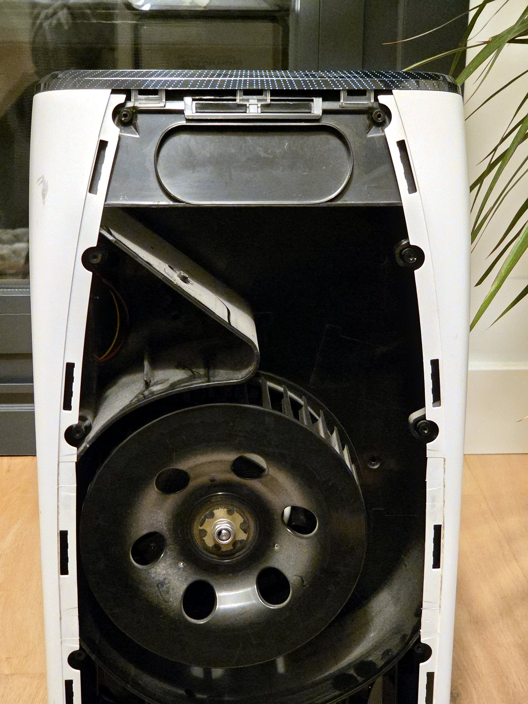
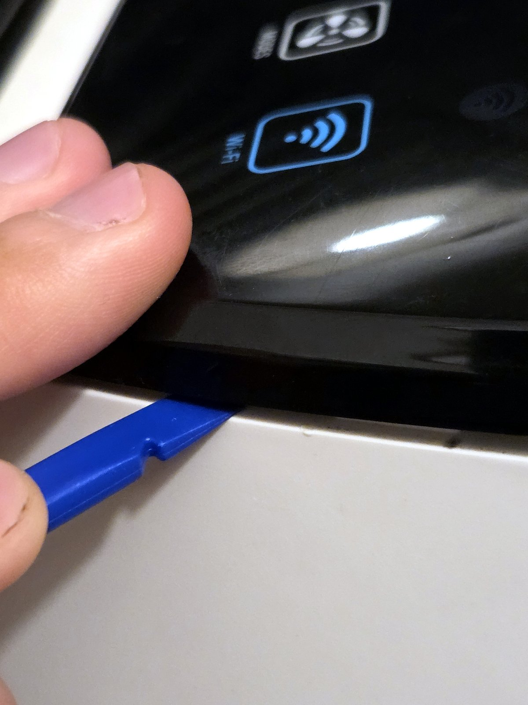
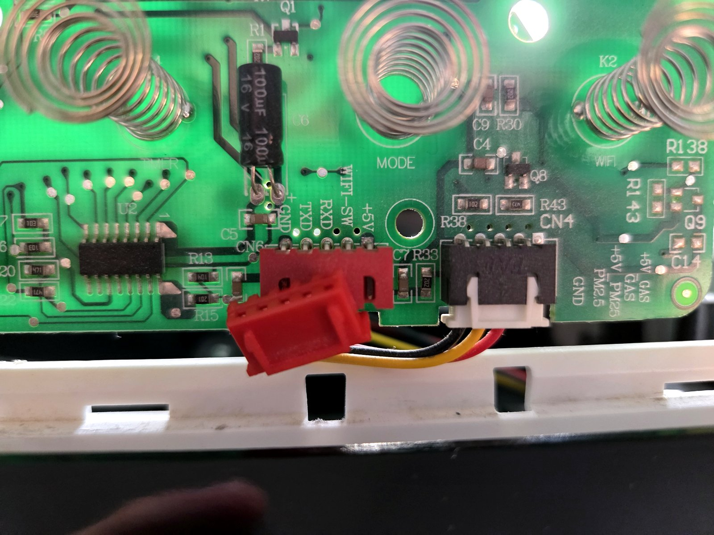
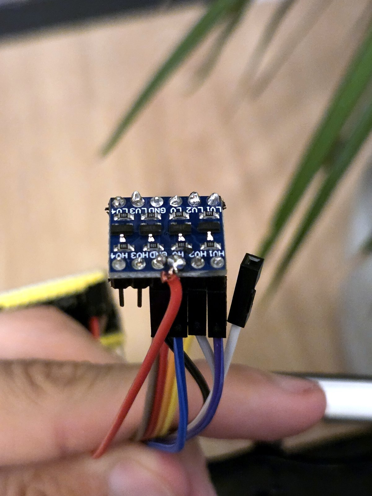
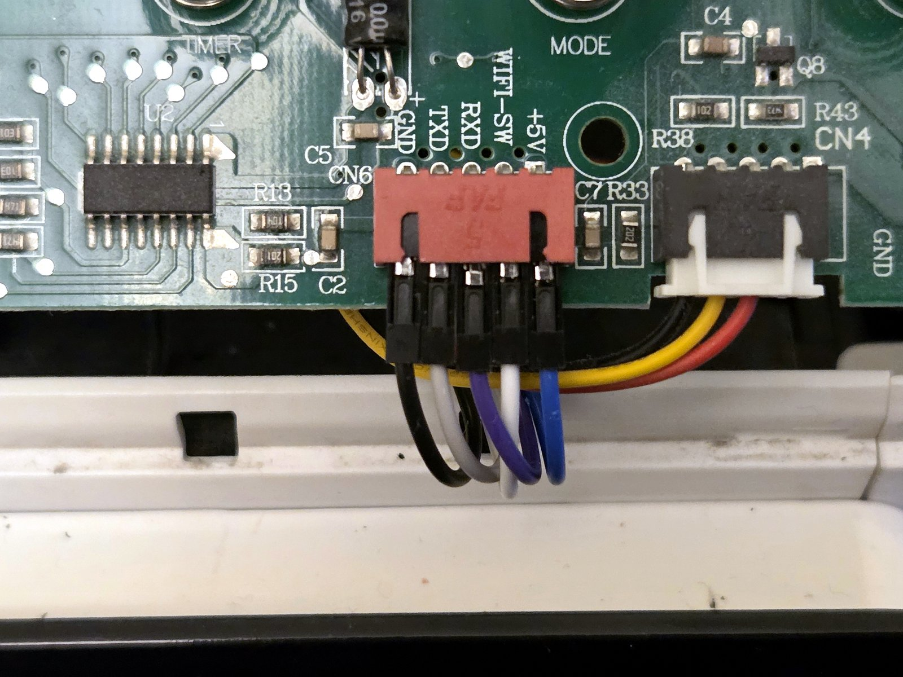

# Installation

> [!WARNING]
> **Unplug the purifier from the mains before opening it**, and keep it unplugged whenever you
> touch the inside. You must know how to solder. If you don't, or don't feel confident, take this
> guide to a professional or someone with more experience. You do this at your own risk; read the
> [safety warnings and disclaimer](../README.md#safety-warnings-and-disclaimer).

You need the parts and tools from the [bill of materials](../README.md#bill-of-materials).
Allow one to two hours the first time.

## 1. Unplug the purifier

Unplug it from the mains and wait a minute.

## 2. Open it: only the black top cover comes off

The goal is to remove the **black top cover** (the one with the buttons). **Nothing else needs to
be taken apart**: the control board and the WiFi module are right under it.

1. **Unscrew the back cover first.** It makes removing the top cover much easier.

   

2. **Pry the black top cover off with a plastic wedge**, between the black cover and the white
   body. Go slowly and spread the force along the edge: **the clips can break** if you force them.

   

## 3. Unplug the original WiFi module

Find the **red connector CN6** on the control board and unplug it. The original module stays
attached to its cable; put it aside (it is not needed, but keep it if you ever want to go back).



## 4. Prepare the level shifter

1. Solder the two header strips to the level shifter (pins pointing down, like a breadboard part).
2. Solder **an extra wire to the `HV` pin**: it will power the ESP32 from the purifier's 5 V.



## 5. Wire it

Follow the table and diagram in [hardware.md](hardware.md#wiring):

| CN6 | Shifter | ESP32-S3 |
|---|---|---|
| GND | GND (both sides) | GND |
| TXD | HV2 → LV2 | GPIO18 |
| RXD | HV1 → LV1 | GPIO17 |
| WIFI-SW | – | – |
| +5V | HV, plus the extra wire | 5Vin |
| | LV | 3V3 |

The Dupont plugs fit on CN6's pins but **are loose**. Once everything works, hold the five
plugs together with tape so none can slip off, or use a 5-pin JST XH cable instead.



## 6. Flash the firmware (over USB)

Do this **with the purifier unplugged** and the ESP32's 5 V wire disconnected (see the warning in
[hardware.md](hardware.md#wiring)), or before wiring it.

1. Install [PlatformIO](https://platformio.org/install) (VS Code extension, or `pip install platformio`).
2. Optional but recommended: create your OTA password so you can update over WiFi later
   (see [firmware/README.md](../firmware/README.md)).
3. Connect the ESP32 by USB and run, from the `firmware` folder:

   ```sh
   pio run -e usb -t upload
   ```

   If the upload doesn't start, hold **BOOT**, press **RST**, release **BOOT** and try again;
   press **RST** once more after it finishes.

## 7. Connect it to your WiFi

1. Disconnect USB, reconnect the 5 V wire, **plug the purifier in**.
2. On your phone, join the WiFi network **`Purifier-Setup`**. A setup page opens (if not, browse to
   `http://192.168.4.1`).
3. Choose your home network and enter its password. **Only 2.4 GHz networks work.**

The setup network closes after 5 minutes. To open it again later (new router, new password),
**hold the WiFi button** on the purifier's panel.

## 8. Open the web page

Browse to **`http://purifier.local`** from a device on the same network. (If your device doesn't
support `.local` names, look up the ESP32's IP address in your router.)

You can turn the purifier on and off, choose the mode, the light, and set up a weekly schedule.
The page also has the fields for Sinric Pro.

The same functions are available as a JSON API:

| Request | What it does |
|---|---|
| `GET /api/status` | `{"valid", "power", "mode", "speed", "light", "lock", "pm25", "time", "rssi", "sinric": {...}}` |
| `POST /api/command` | Body `{"power": true}`, `{"mode": 3}` (1 Silent, 2 Night, 3 Auto, 4 Turbo) or `{"light": 2}` (0 on, 1 dim, 2 off) |
| `GET`/`POST /api/schedule` | List of `{"days", "hour", "minute", "action"}`; `days` bit 0 = Monday, `action` 0 = off, 1–4 = on in that mode |
| `GET /api/log` | Last 40 events (Sinric commands, alerts…) |

Send POST bodies with the header `Content-Type: application/json`.

## 9. Google Home and Gemini (optional)

Follow [sinric-google.md](sinric-google.md).

## 10. Put everything inside and close it

- Place the ESP32 and the level shifter inside the top part, away from the motor and from metal
  parts, with the ESP32's antenna end free. The author placed them under the top grille.
- Don't block the air inlets or outlets, and keep the wires away from the fan.
- Check that no bare pin can touch another (tape or a small case helps).
- Put the black top cover back (clips first, gently), then screw the back cover on.


## Updating later

Once installed, update over WiFi from the `firmware` folder:

```sh
pio run -e ota -t upload
```

This needs the OTA password set up before the first USB flash
(see [firmware/README.md](../firmware/README.md)).
