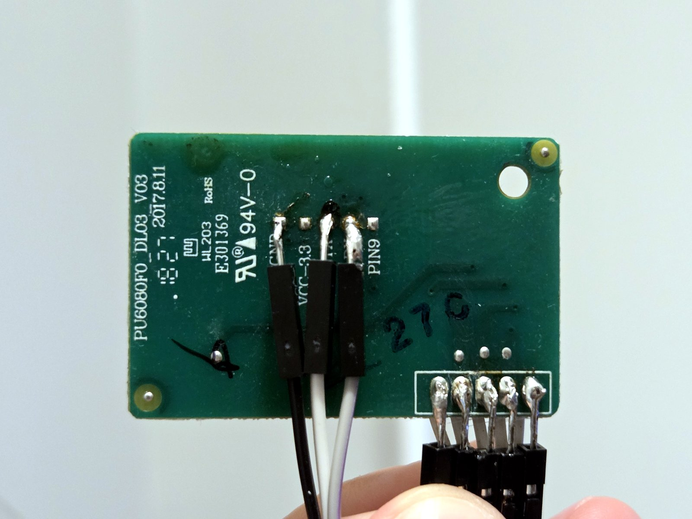

# Research tools: capturing and decoding the signals

This guide explains how the protocol was found, so you can do the same on a model that isn't
covered yet (or simply check that yours speaks the same language before installing the ESP32).
You **don't need any of this** to install the firmware on a compatible purifier.

## What you need

**Hardware**

| Item | Notes | Approx. price |
|---|---|---|
| USB logic analyzer, 24 MHz, 8 channels | The common "Saleae Logic clone" (Cypress FX2 chip, label *Logic Analyzer 24MHz 8CH*). Plenty for a 9600 baud serial line. | ~10 € |
| Dupont jumper wires and thin wire | To connect the analyzer to the board | ~5 € |
| Soldering iron and solder | To attach thin wires to test pads | – |
| Multimeter | To identify pins and check the isolation | – |
| *Optional:* ESP32-S3 + level shifter | To talk to the board from the PC (the same parts as the final build) | ~15 € |

**Software** (all free)

- **sigrok-cli** and **PulseView** ([sigrok.org](https://sigrok.org)). Recent Windows builds are
  also published on GitHub: [sigrok-cli](https://github.com/sigrokproject/sigrok-cli/releases)
  and [PulseView](https://github.com/sigrokproject/pulseview/releases) (*continuous* release).
- On Windows, **[Zadig](https://zadig.akeo.ie)** to install the WinUSB driver for the analyzer.
- **Python 3** with the packages in [tools/requirements.txt](../tools/requirements.txt), for the
  scripts in [tools/](../tools/).
- **PlatformIO**, only to flash the bridge firmware.

> [!NOTE]
> Saleae's own software (Logic 2) **does not work** with these clones. They enumerate with
> USB ID `0925:3881` and work with sigrok's `fx2lafw` driver.

## 1. Safety first: check the isolation

The PC will be connected to the purifier's electronics while the purifier is plugged into the
mains, so first make sure its low-voltage side is isolated from the mains:

1. **Unplug the purifier.**
2. Measure between the board's **GND** (for example the GND pin of CN6) and **each pin of the
   mains plug**, in diode-test mode **in both polarities** (swap the probes), and again on the
   highest resistance range. A single measurement in one direction can read open through a
   reverse-biased rectifier diode.
3. Every reading must be **open (OL)**. If any reads a voltage drop or a resistance, **stop**:
   don't connect a PC.
4. If in doubt, use a battery-powered laptop (charger unplugged) or a USB isolator.

On the PU4080F0 the readings are open (OL).

## 2. Install the analyzer driver (Windows)

1. Plug the analyzer in.
2. Open Zadig, *Options → List All Devices*, pick the analyzer (it may appear as an unknown device
   or with the `0925:3881` ID), choose **WinUSB** and click *Replace/Install Driver*.
3. In PulseView the device appears as **fx2lafw (Saleae Logic)**. From the command line:
   `sigrok-cli --scan`.

On Linux and macOS no driver is needed (on Linux, install sigrok's udev rules).

## 3. Find the signals with a multimeter

Purifier plugged in, measure each pin against GND (DC volts):

| What you read | Probably |
|---|---|
| 0 V, continuity with GND when unplugged | GND |
| Steady 3.3 V or 5 V | Supply, or a data line resting high |
| Steady high, flickering slightly | A data line (UART lines rest high) |
| Around 0.2 V, or changing when you press a button | A data line pulled low between frames, or a status line |

On the original module's test pads the author measured `VCC-3.3` = 3.3 V, `TX` and `RX` = 3.3 V,
and `PIN9` ≈ 0.2 V, rising to 3.3 V in pairing mode.

## 4. Connect the analyzer

The easiest place to listen is the **original module's test pads** (3.3 V side): solder thin
wires to `GND`, `TX` and `RX` (and `PIN9` if you're curious) and put Dupont plugs on the other end.



| Analyzer | Connect to |
|---|---|
| **GND** | Module `GND` |
| **CH1** (D0 in sigrok) | Module `TX` (what the module sends) |
| **CH2** (D1 in sigrok) | Module `RX` (what the board sends) |
| CH3 (D2), optional | Module `PIN9` |

You can also listen on CN6 (5 V side) with the module plugged in; most of these analyzers accept
5 V inputs, but check yours. On CN6, `TXD` is what the board sends and `RXD` what the module sends.

Put the module back in place, close the purifier as much as the wires allow, plug it in.

## 5. Record

**With PulseView:** select the *fx2lafw* device, enable D0 and D1, set the sample rate to
**1 MHz** (at least ~10× the baud rate) and the length to a few minutes, then *Run*.

**With the script:** from the `tools` folder,

```sh
python capture.py record 120 my-test
```

records 120 s at 1 MHz on D0/D1 into `captures/my-test.sr` and decodes it right away.

Useful recordings to make:

- **idle**: purifier on, nothing touched, a couple of minutes;
- **buttons**: press each panel button once, slowly, **writing down the time** of each press;
- **boot**: plug the purifier in while recording (shows the module's start-up exchange).

## 6. Decode

**In PulseView:** add the **UART** decoder on D0, set **9600 baud, 8 data bits, no parity,
1 stop bit**; add a second UART decoder on D1. You'll see bytes like `FF FF 00 05 07 ...`.

If you don't know the baud rate, zoom in on the shortest pulse: its width is one bit. 104 µs means
9600 baud, 52 µs 19200, 8.7 µs 115200.

**Recognise the protocol:** frames that start with **`FF FF`** followed by a 2-byte length are the
**Gizwits** serial protocol described in [protocol.md](protocol.md).

**With the script:**

```sh
python capture.py show my-test
```

prints every frame with its direction and name, the status bytes of each report, and a
`CHANGES:` line listing which bytes changed since the previous report:

```
  20.551s board->module status report sn=2D [status]
                        00 00 00 06 00 00 00 00 00 03 B3 00 ...
                        CHANGES: byte 3: 08->06
  20.653s module->board status report ack sn=2D
```

Match the `CHANGES` lines with the times of your button presses to map each status byte. Byte 3
changing on its own is the particle sensor.

The board pulls its TX line low between frames, so decoders may show framing errors there; they
are harmless. Example recordings and their decodes are in [captures/](../captures/).

## 7. Talk to the board from the PC (bridge)

Listening shows what exists; to test commands you need to **replace the module** with something
you control:

1. Flash [firmware-bridge/](../firmware-bridge/) to an ESP32-S3 (`pio run -t upload` in that
   folder). It forwards bytes between USB and the board at 9600 baud.
2. Unplug the purifier, unplug the module from CN6 and wire the ESP32 exactly as in
   [hardware.md](hardware.md#wiring), but **power the ESP32 from USB only** (leave the 5Vin wire
   disconnected; HV still goes to CN6 +5V). The loose end of that wire carries 5 V once the
   purifier is plugged in: **insulate it** with tape or heat-shrink.
3. Plug the purifier in. From the `tools` folder (set `BRIDGE_PORT` if the ESP32 isn't on COM4):

   ```sh
   python bridge.py send 07 -      # heartbeat: the board starts talking after this
   python bridge.py send 03 02     # read the status
   python bridge.py listen 60      # watch reports for 60 s (they are acknowledged for you)
   ```

The bridge also helps identify unknown pins: after 100 ms of silence, sending the byte `A` makes
it measure GPIO4 and GPIO5 with the internal pull-up enabled (`#MV 4=x 5=y#`). A real ground reads
~0 mV, a pin with a pull-down resistor to ground reads hundreds of mV (that's how `WIFI-SW` was
found to have ~10 kΩ to GND). `T` reports their digital levels.

## 8. Writing: be careful

[tools/write_probe.py](../tools/write_probe.py) sends write payloads and shows which status bytes
change; [tools/map_fields.py](../tools/map_fields.py) scans the field mask one bit at a time.
**Read [the mode 0 incident](protocol.md#the-mode-0-incident) first**: always send full-length
payloads and never mode 0. Writes can leave the board in a state that survives unplugging.

## Share what you find

If you decode another model, please open an issue with your findings and recordings, or a pull
request with a new section in [protocol.md](protocol.md).
